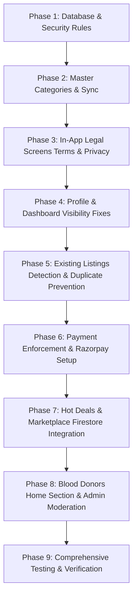

# Kurnool One – Master Implementation Plan
## Complete Platform Fixes & Blood Donors Integration

> **Project:** Kurnool One (Mobile App & Website Directory)  
> **Date:** October 18, 2026  
> **Status:** Architecture Approved • Ready for Implementation  
> **Architecture Principle:** Reuse existing single-login, Firebase backend, Firestore DB, Razorpay integration, and UI design system. Zero disruption to existing data.

---

## 1. Technical Architecture & Root Cause Findings

### 1.1 Marketplace (Permissions & Authorization)
* **Root Cause:** Marketplace currently renders static mock data (`SEED_MARKET_ITEMS`) inside `frontend/src/screens/OffersScreen.tsx`. There is no Firestore collection, no posting mechanism, and no permission rules in `firestore.rules`.
* **Architecture Solution:**
  * Create `marketplace` collection in Firestore.
  * Fields: `id`, `title_en`, `title_te`, `price`, `category`, `description`, `images`, `sellerName`, `sellerPhone`, `sellerWhatsapp`, `sellerUid`, `area`, `condition`, `status` ('active' | 'sold' | 'suspended'), `createdAt`, `updatedAt`.
  * Security rules:
    * `allow read: if true;`
    * `allow create: if isAuthenticated() && request.resource.data.sellerUid == request.auth.uid;`
    * `allow update, delete: if isAuthenticated() && (resource.data.sellerUid == request.auth.uid || isAdmin());`
  * Add "+ Post Item" authenticated bottom-sheet / modal in `OffersScreen.tsx` with owner edit/delete/mark sold options.

---

### 1.2 Business Category: "Chicken and Mutton Center"
* **Root Cause:** Category is missing from `frontend/src/data/masterCategories.ts`, `frontend/src/services/directoryService.ts`, `website/src/data/masterCategories.ts`, `website/src/services/directoryService.ts`, and Firestore categories sync.
* **Category Definition:**
  * **ID:** `chicken_mutton_center`
  * **Name (English):** `Chicken and Mutton Center`
  * **Name (Telugu):** `చికెన్ మరియు మటన్ సెంటర్`
  * **Icon:** `nutrition` (Ionicons) / `UtensilsCrossed` (Lucide)
  * **Color:** `#DC2626`, **Light BG:** `#FEF2F2`
  * **Subcategories:**
    1. Fresh Raw Chicken (`తాజా చికెన్`)
    2. Fresh Mutton (`తాజా మటన్`)
    3. Country Chicken / Natu Kodi (`నాటు కోడి`)
    4. Sea Food & Fish (`చేపలు & సీ ఫుడ్`)
    5. Eggs & Poultry (`గుడ్లు & పౌల్ట్రీ`)
* **Scope of Update:**
  * Master category lists across mobile and web.
  * Registration dropdowns in `RegisterBusinessScreen.tsx` and web `register-business/page.tsx`.
  * Management & Editing in `ManageBusinessScreen.tsx` and web `business/dashboard/page.tsx`.
  * Directory filter tabs in `DirectoryScreen.tsx` and web `directory/page.tsx`.
  * Search engine in `SearchScreen.tsx`.
  * Admin sync in web `admin/page.tsx` (`syncMasterCategoriesToFirestore`).

---

### 1.3 Existing Listings Detection & Duplicate Prevention
* **Root Cause:** `RegisterBusinessScreen.tsx` and `RegisterProfessionalScreen.tsx` open directly to blank registration forms without checking if the authenticated user already owns an active listing.
* **Architecture Solution:**
  * On mount of `RegisterBusinessScreen.tsx` and `RegisterProfessionalScreen.tsx`, trigger Firestore query `fetchMyBusinesses` and `fetchMyProfessionalProfile` using `auth.currentUser.uid` and stored phone.
  * If existing listings are detected:
    * Render an **Existing Listing Detected Modal/Banner**:
      * Display listing title, category badge, and current status.
      * **Button 1 (Primary):** "Manage Existing Listing" $\rightarrow$ Navigates directly to `ManageBusinessScreen` or `ManageProfessionalScreen`.
      * **Button 2 (Secondary):** "Register Another Listing" $\rightarrow$ Dismisses prompt and allows registering a separate branch/listing.
  * Duplicate Prevention: Verify storefront name and phone number against existing records to prevent accidental double-submits.

---

### 1.4 Profile Screen: Camera Icon Removal
* **Root Cause:** `ProfileScreen.tsx` lines 154–158 renders a floating camera icon (`<TouchableOpacity style={styles.cameraIcon}>`) overlaid on the user avatar, linking to `EditProfileScreen`.
* **Architecture Solution:**
  * Remove `<TouchableOpacity style={styles.cameraIcon}>` and its stylesheet rule `cameraIcon`.
  * Keep the circular profile image wrapper, default user icon fallback, user display name, phone/email, and directory statistics completely functional.
  * Clean up `EditProfileScreen.tsx` avatar section.

---

### 1.5 Business & Professional Dashboards Visibility
* **Root Cause:**
  * In `ProfileScreen.tsx:L113-L114`, dashboard visibility checks `currentUser?.role === 'business'` or `'professional'`.
  * In single-login systems, citizen users sign in via phone/Google and have `role: 'user'` in their Firestore document. Even when they register a business/professional listing, their session role often remains `'user'`.
  * Consequently, `ProfileScreen` treats them as non-owners and routes them to **Register** instead of **Manage**!
* **Architecture Solution:**
  * Replace role-only check with direct listing ownership verification: query `businesses` (`where ownerUid == currentUser.uid`) and `professionals` (`where userId == currentUser.uid`).
  * If a listing exists and has verified payment, immediately display:
    * **"My Business Dashboard & Leads (ACTIVE)"** $\rightarrow$ `ManageBusinessScreen`
    * **"My Professional Dashboard & Clients (ACTIVE)"** $\rightarrow$ `ManageProfessionalScreen`
  * In `ManageBusinessScreen.tsx`, add a shop switcher dropdown for owners with multiple businesses.

---

### 1.6 Payment-Based Access & In-App Terms and Conditions
* **Payment Enforcement:**
  * In `ManageBusinessScreen.tsx` and `ManageProfessionalScreen.tsx`, check `listing.paymentStatus === 'paid'`.
  * If status is `'unpaid'`, `'pending'`, or `'failed'`:
    * Render a locked management view with plan details and a **"Complete Subscription via Razorpay"** button.
    * Prevent editing storefront details or publishing deals until payment verification succeeds.
  * Update `firestore.rules` so clients cannot overwrite `paymentStatus: 'paid'` without valid payment verification audit records.
* **In-App Terms and Conditions:**
  * Create `frontend/src/screens/TermsScreen.tsx` featuring the complete User Agreement, Listing Accuracy Policy, Role Exclusivity, and Jurisdiction terms from `website/src/app/terms/page.tsx`.
  * Register in `AppNavigator.tsx`.
  * Replace external browser redirects in `SettingsScreen.tsx` and `MobileFirebaseLogin.tsx` with `navigation.navigate('Terms')`.

---

### 1.7 In-App Privacy Policy Screen
* **Architecture Solution:**
  * Create `frontend/src/screens/PrivacyPolicyScreen.tsx` containing the full, Google Play compliant privacy policy from `website/src/app/privacy/page.tsx` (including India DPDP Act 2023 compliance, Zero SMS Permission declaration, and Account Deletion instructions).
  * Register in `AppNavigator.tsx`.
  * Replace all external `Linking.openURL` / `WebBrowser` calls in `SettingsScreen.tsx`, `MobileFirebaseLogin.tsx`, and registration footers with `navigation.navigate('PrivacyPolicy')`.

---

### 1.8 Hot Deals Navigation & Experience
* **Root Cause:** `OffersScreen.tsx` does not have a navigation header with a Back button. When navigated from the `HomeScreen` "Hot Deals" pill, the user cannot go back to Home via app controls.
* **Architecture Solution:**
  * Add a back button header in `OffersScreen.tsx`:
    ```tsx
    {navigation.canGoBack() && (
      <TouchableOpacity onPress={() => navigation.goBack()} style={styles.backBtn}>
        <Ionicons name="arrow-back" size={24} color="#111827" />
      </TouchableOpacity>
    )}
    ```
  * Support `{ initialTab: 'offers' }`, `{ initialTab: 'marketplace' }`, and `{ initialTab: 'events' }`.
  * Add pull-to-refresh (`RefreshControl`), active deal expiration filtering, and error retry state.

---

### 1.9 Blood Donors Feature
* **Database Collection:** `blood_donors`
* **Schema:**
  ```typescript
  export interface BloodDonorItem {
    id: string;
    userId: string;
    displayName: string;
    bloodGroup: 'A+' | 'A-' | 'B+' | 'B-' | 'AB+' | 'AB-' | 'O+' | 'O-';
    phone: string;
    showPhonePublicly: boolean; // Explicit donor consent
    area: string; // Kurnool locality
    availability: 'available' | 'donated_recently' | 'unavailable';
    notes?: string;
    status: 'active' | 'suspended';
    createdAt: any;
    updatedAt: any;
  }
  ```
* **Security Rules (`firestore.rules`):**
  ```javascript
  match /blood_donors/{donorId} {
    allow read: if true;
    allow create: if isAuthenticated() && request.resource.data.userId == request.auth.uid;
    allow update, delete: if isAuthenticated() && (resource.data.userId == request.auth.uid || isAdmin());
  }
  ```
* **Home Screen Section:**
  * Dedicated "Kurnool Blood Donors" emergency card on `HomeScreen.tsx`.
  * Blood group filter pills: `All`, `A+`, `A-`, `B+`, `B-`, `AB+`, `AB-`, `O+`, `O-`.
  * Donor card: Name, Blood Group pill, Locality, and "Call Donor" button (active if donor consented).
  * Prominent **"Register as Blood Donor"** button.
* **Consent & Medical Notice:**
  * Mandatory donor consent toggle: *"I consent to share my phone number with Kurnool citizens needing blood for emergency patients."*
  * **Mandatory Medical Disclaimer Banner:**
    > *"Medical Notice: Kurnool One is an independent civic directory and does not medically test or verify blood donors. Hospitals and qualified healthcare professionals must confirm blood compatibility, cross-matching, and donor eligibility before any transfusion."*
* **Donor Self-Management:**
  * Donors can update their availability, change contact details, or delete their donor profile at any time.
* **Admin Console Integration:**
  * Add **Blood Donors** moderation tab in Mobile `AdminDashboardScreen.tsx` and Web `website/src/app/admin/page.tsx` with search, suspend/activate, and removal controls.

---

### 1.10 Razorpay Test Mode Corrections
* **Verified Credentials:**
  * Key ID: `rzp_test_Tj21FRIRtpaQcO`
  * Key Secret: `Pdnh16bOuzcNxdufHJjE6NcD`
  * Verified working via live API test against `https://api.razorpay.com/v1/orders`.
* **Corrections Needed:**
  * In `website/src/app/register-business/page.tsx:L408`, remove invalid fallback `rzp_test_kurnool_one` and use `orderData.keyId` returned from server.
  * In the mobile app, connect checkout with real order ID generation and signature verification before activating listings.

---

## 2. Step-by-Step Implementation Phases



### Phase 1: Database & Security Rules
1. Update `firestore.rules` to include:
   * `/marketplace/{itemId}` rules.
   * `/blood_donors/{donorId}` rules.
   * Secure payment field updates for `/businesses` and `/professionals`.

### Phase 2: Master Categories
1. Add `chicken_mutton_center` to `frontend/src/data/masterCategories.ts`.
2. Add `chicken_mutton_center` to `website/src/data/masterCategories.ts`.
3. Update `directoryService.ts` in both frontend and website.
4. Update `website/src/app/admin/page.tsx` category sync function.

### Phase 3: In-App Legal Screens
1. Create `frontend/src/screens/TermsScreen.tsx`.
2. Create `frontend/src/screens/PrivacyPolicyScreen.tsx`.
3. Register both screens in `frontend/src/navigation/AppNavigator.tsx`.
4. Update all links in `SettingsScreen.tsx`, `MobileFirebaseLogin.tsx`, and registration forms.

### Phase 4: Profile & Dashboard Visibility
1. Update `frontend/src/screens/ProfileScreen.tsx`:
   * Remove camera icon and its handler from avatar.
   * Query `fetchMyBusinesses` and `fetchMyProfessionalProfile` by `uid`.
   * Render active dashboard entry points for owners with paid listings.
2. In `ManageBusinessScreen.tsx`, add multi-listing selector.

### Phase 5: Existing Listings Detection
1. Update `RegisterBusinessScreen.tsx` with pre-registration ownership detection and duplicate check modal.
2. Update `RegisterProfessionalScreen.tsx` with existing profile detection.

### Phase 6: Payment Enforcement
1. Add payment status verification gate in `ManageBusinessScreen.tsx` and `ManageProfessionalScreen.tsx`.
2. Clean up Razorpay checkout keys in website and mobile app.

### Phase 7: Hot Deals & Marketplace
1. Add back button and error retry state in `OffersScreen.tsx`.
2. Implement Firestore persistence for marketplace items with seller ownership checks.

### Phase 8: Blood Donors Feature
1. Implement blood donor service methods in `directoryService.ts`.
2. Add Blood Donors section and filter pills to `HomeScreen.tsx`.
3. Create donor registration modal with single login, phone consent, and medical notice.
4. Add donor moderation tab to mobile and web admin dashboards.

### Phase 9: Verification & Testing
1. Test mobile navigation, login, category filtering, legal screens, donor flow, and dashboard access.
2. Run automated TypeScript checks and linting across `frontend` and `website`.
